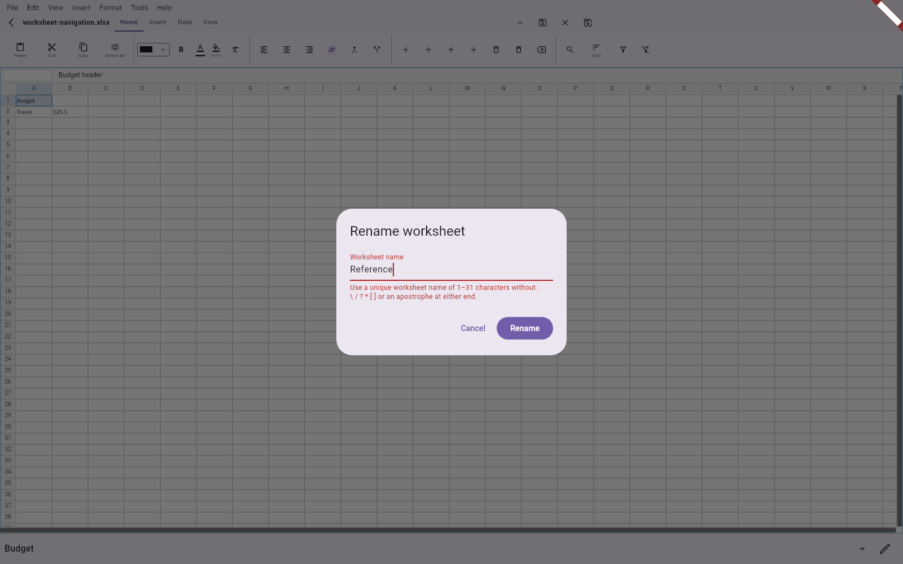
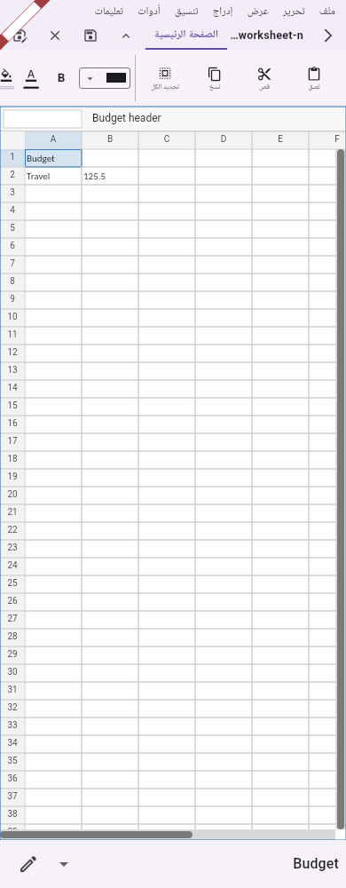

# Preview visual review

**PASS for the assessed captured controls.** Both original retained PNGs were
opened and inspected directly. No image was redrawn, edited, or substituted.
The machine-readable record is [visual-review.json](visual-review.json).

## Duplicate-name validation — English, 1600 × 1000

The complete Rename worksheet dialog is readable. The `Reference` input,
complete red validation guidance, and Cancel/Rename controls fit within the
dialog. The guidance wraps without clipping. The worksheet and its lower
selector remain present behind the modal.

## Narrow worksheet — Arabic, 390 × 1000

Arabic menu and ribbon labels render with joined glyphs. The lower worksheet
name/selector and rename pencil remain visible within the narrow viewport; the
bottom bar is not cut off. Visible worksheet cells remain legible. The filename
uses ellipsis, and the grid exposes horizontal scrolling. This review does not
claim that every control from a wide ribbon fits simultaneously.

## Evidence boundary

The [independent verifier](navigation-independent-review-final-artifacts/verification.json)
separately checks both dimensions, exact image/source hashes, six font assets,
and the six generated workbook semantics. This visual review evaluates the
actual appearance of these two captures; it does not certify every viewport,
translation, external Office renderer, or general document layout.
