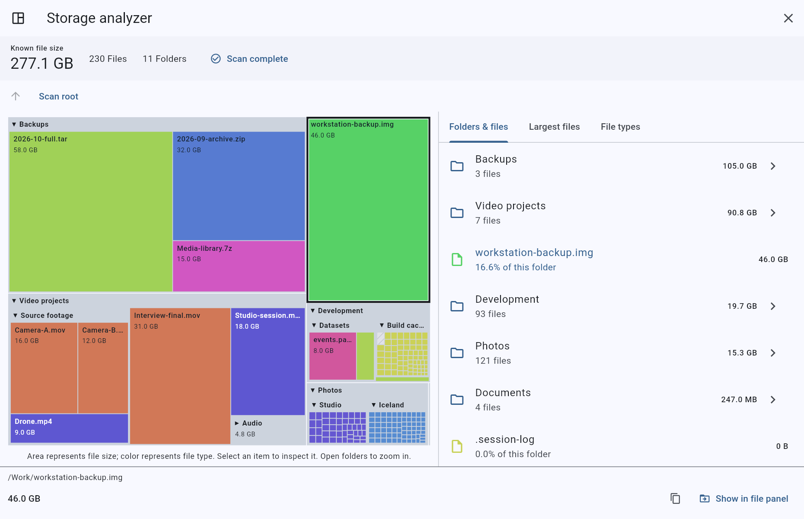
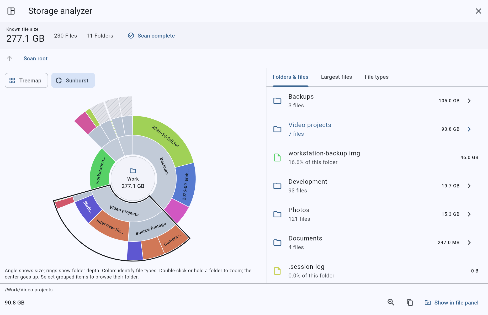
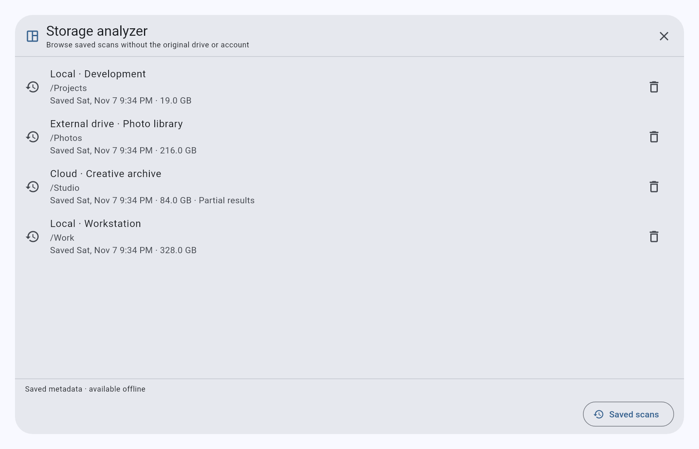

# Storage analyzer

The storage analyzer provides a GrandPerspective / WinDirStat-style view of the
folder in the active file panel. It recursively reads folder metadata and shows
which files and subfolders account for the most space. The same view works with
local folders, browser-granted local folders, and connected cloud providers.



The screenshot uses a test fixture, not a live account. A
[compact dark layout](images/storage-analyzer-compact.png) is also shown.

The same scan can also be explored as a sunburst. Switching views never rescans
the source:



A [compact dark sunburst](images/storage-analyzer-sunburst-compact.png) is
available as well.

## Open and explore

1. Navigate to the folder to analyze and wait for its listing to finish loading.
2. Choose **Storage analyzer** in the **Tools** menu or the overflow menu. It is
   also available in the command palette. On macOS it is available in the
   native View and Tools menus.
3. Watch the file, folder, and byte counts while the scan runs. **Stop scan**
   preserves the portion already measured. A currently running provider listing
   finishes before cancellation takes effect; closing the dialog also stops
   further traversal.
4. Select a rectangle or a list row to inspect its path and size. Use the
   folder's arrow, or double-click / long-press its map header, to zoom into it.
   The breadcrumbs and parent button navigate back through the scan.
5. Open **Largest files** to browse the largest 200 files in the current subtree.
   Filter by name or path, or choose an extension in **File types** to restrict
   the list to that type. Clear the type chip to show all types again.
6. Use **Copy path** or **Show in file panel** for the selected item. The latter
   navigates the original panel and selects the original file; existing file
   manager actions can then manage it. **Scan again** refreshes the same captured
   folder and storage account.
7. Select **Treemap** or **Sunburst** above the map. In the sunburst, angular
   span represents known bytes and rings show folder depth. Click to select;
   double-click or hold a folder to zoom. Click the center to go up. Selecting
   a hatched group opens its folder list.

Desktop layouts show the map beside the lists. Narrow layouts expose the map
and lists as tabs. All entries remain available in the folder list, including
empty files and items that have no measurable map area. Controls follow the app
theme, support keyboard focus, and include tooltips and semantic labels. New
tool text is translated in English and German; other app locales use English
fallback for messages without a translation.

## Save, reopen, and update

Choose **Save scan** after a completed or partial scan. **Saved scans** opens
the saved history. A report can be explored without the original drive,
folder grant, or cloud account, including both maps and all detail lists.
Historical reports show their scan time; partial results remain partial.



Each save creates a separate immutable snapshot. **Rescan original folder**
performs a full new scan when the original source and root match the captured
live panel. Choose **Save scan** again to retain the new result alongside the
previous one. This is a full refresh, not change-journal-based incremental
updating. A folder's modification time alone is not used to skip descendants.

Saved data includes Unicode names, exact zero-byte sizes, explicit empty
directories, timestamps, unknown-size markers, skipped links, scan diagnostics,
and an opaque storage reference. No client, access token, grant, file contents,
or arbitrary provider metadata is serialized. Saving a scan does not write to
the scanned folder or cloud account.

Native installations store independent records in application support storage;
the browser stores them in IndexedDB. These are local saved reports, without
automatic cross-device synchronization or portable export. This analyzer does
not currently import or export Cathy `.caf` files. The native snapshot format
is independent of catalog interchange formats.

Opening history never grants access to the original source. Reveal and rescan
require a matching live source and root; a different account stays read-only.
Browser-local snapshots use a grant-session identity, so a later picker grant
with the same folder name cannot activate an older report's live actions.
When no real scan source is available, opening the analyzer opens history.

Pages are immutable and checksummed. A small atomic history update publishes
them only after the complete snapshot has been written. Failed saves retain
earlier reports; corruption and unsupported versions produce explicit errors.
History admits 100 saved scans, with up to 200,001 nodes and 128 MiB of page
data per scan. Reaching a limit does not erase previous reports. Deleting a
history item removes only that saved metadata, without deleting source files.

## Reading the map and totals

- Rectangle area represents the **known file size**; nested rectangles preserve
  folder grouping. Folder headers and borders reserve a small amount of display
  space, so compare sizes within the same folder level.
- File color is derived deterministically from its lowercase extension. The
  **File types** list uses the same colors and reports counts and sizes.
- Tiny items or branches beyond the display budget are grouped in a hatched
  rectangle. Their combined bytes remain represented. Use the folder list or
  zoom into that branch to inspect them individually.
- A folder total is the sum of its known descendant file sizes, not a size
  returned for the directory itself. Native and cloud scans include hidden files,
  regardless of the panel's display filters. Browser-local snapshots have the
  limitations described below.
- **Partial results** and `+ ?` indicate that some sizes are unknown or some
  entries could not be scanned. Click the scan status for details about skipped
  links, unreadable folders, incomplete provider listings, or traversal limits.
  Zero-byte files and files with unknown sizes remain distinct.

The analyzer reads metadata, without downloading or hashing file contents.
Sizes are the bytes reported by the storage provider. They are not filesystem
allocation, free disk space, or the account's billed/quota usage. Sparse files,
compression, hard links, cloud revisions, trash, provider-native documents and
encrypted-storage overhead can make those quantities differ. Hard-linked files
are counted by listed path; symbolic links are excluded rather than followed.
Changing files during a scan can also make the snapshot differ from a later
listing.

## Scope, limits, and incomplete listings

The scan begins at one real folder in one captured storage account. Archive and
container views, search results and saved collections are not scan roots. An
account disconnect or replacement stops the scan and marks the result partial;
it cannot redirect the analyzer or its reveal action into a different account.
Locked tabs, declined folder access and failed reveals keep the report open.

Browser-local scans require a selected folder. The existing browser file service
can return cached listings, omit hidden names and suppress listing failures, so
these results are explicitly marked partial rather than claiming a complete
disk census. The selected folder grant is captured; replacing it invalidates the
scan instead of redirecting reads into a new folder. Native local and cloud
scans use their regular metadata listing contracts.

Most provider adapters consume all listing pages themselves. When an adapter
exposes another page or reports an incomplete response, the analyzer retains
known entries and marks that subtree partial. It does not invent continuation
requests for adapters without a pagination interface. Native B2's virtual
bucket-index root is not a normal recursive filesystem root. Use an
S3-compatible bucket connection to analyze its contents; virtual bucket rows
are excluded and the result is marked incomplete.

Default scan limits are 200,000 entries, 200 levels of directories, and 1,000
individual diagnostics. Additional diagnostics are counted. Sizes and totals
must remain within the exact shared VM/JavaScript integer range
(`2^53 - 1` bytes). A limit produces a partial result; choose a smaller folder
to inspect the remainder. The treemap renders at most 1,000 tiles; the sunburst
renders at most 600 sectors and five rings. The largest-files list displays at
most 200 matches. These display limits do not change scan totals or the
browsable folder list.

Native directory metadata is read synchronously in one reusable background
isolate per scan while the original access scope remains held for each directory.
This avoids per-file asynchronous I/O scheduling and repeated worker startup.
The reader reuses the initial no-follow type from enumeration and checks again
after reading metadata. It checks each directory before and after listing, so
the scanner can omit a redundant generic pre-descent stat only for readers
that explicitly provide that guard. Good siblings remain visible when one
entry's metadata fails. Each scan closes its own worker after pending reads
finish, including cancellation, source changes, and access errors.
Cancellation is applied after the current directory finishes. A single very
large directory is still fully listed before the global entry budget applies.
The result is an observed metadata snapshot, not an atomic filesystem snapshot.

## Measured local performance

On 2026-11-07, a warm synthetic Linux overlay-filesystem fixture contained
24,000 sparse files, 460 directories, and 359,116,800 logical bytes. Measurements
used Flutter 3.47.8 / Dart 3.13.7 in the Flutter test VM, an AMD EPYC 9V74 host
with nine CPUs visible to the process, one warmup and five measured runs, and
no hashing. Startup/compilation and correctness validation were outside the
timed interval. Each measured scan validated every file path and size against
an independently generated manifest, plus exact counts and total bytes.

| Operation | Median | Measured range |
| --- | ---: | ---: |
| Previous native adapter, complete scan and aggregation | 6,435.569 ms | 6,188.108–7,263.964 ms |
| First background adapter, one worker per directory | 899.095 ms | 876.555–944.697 ms |
| Current Dart adapter, one reusable worker per scan | **500.381 ms** | **487.567–516.123 ms** |
| Save existing result through native disk storage | 464.079 ms | 459.854–492.449 ms |
| Load and validate native saved result | 422.782 ms | 403.498–446.355 ms |

The current complete scan is **1.80× faster** than the first background adapter
and **12.86× faster** than the original operation backend on this fixture.
The current measurement includes worker creation, directory access wrappers,
source checks, path validation, progress/cancellation checkpoints, immutable
tree aggregation, and awaited worker shutdown. It uses commit
`dec6e90e83532612b326d5b7c7ff76c0ccfbd966`.
Save and load were measured separately through the real native storage implementation, including
flush, atomic publication, checksums and validation. All 24,461 nodes, file and
directory metadata, scan times, and diagnostics survived exact round trips.
The richer native snapshot occupied approximately 7.8 MB per report.

A directory-heavy fixture with 1,010 empty directories improved from
1,151.184 ms through the original backend to 855.743 ms with the first
background adapter, then to **155.165 ms** (122.488–162.179 ms) with the current
per-scan worker. This additional **5.52×** improvement reflects the removal of
repeated worker startup, duplicate folder metadata calls, and unconditional
per-directory event-loop delays. The scanner still yields periodically even
for cached or failed listings.

These are measured fixture results, not cold-drive, network-mount, cloud API,
or release-build guarantees. Provider listing latency remains a separate
constraint. Raw CrispCloud measurements are recorded in
[the benchmark data](benchmarks/storage-scan-linux-2026-11-07.json).

The separate [scan engine comparison](storage-scan-performance.md) examines
the remaining Rust/Dart gap, AOT compilation, matched tree workloads, and a
bounded Rust-to-Dart FFI prototype. The FFI experiment is reproducible under
`tool/benchmarks/native_scan_lab`; it is not an app dependency or a shipping
scan backend. The app's scanner remains pure Dart.

Reproduce the metadata benchmark with a new disposable directory:

```sh
python3 tool/create_storage_scan_fixture.py /tmp/crisp-scan-fixture
STORAGE_SCAN_BENCHMARK_ROOT=/tmp/crisp-scan-fixture \
STORAGE_SCAN_BENCHMARK_MANIFEST=/tmp/crisp-scan-fixture.manifest.json \
flutter test --no-pub --tags benchmark --run-skipped \
  test/storage_scan_benchmark_test.dart
```

Set `STORAGE_SCAN_BENCHMARK_LEGACY=1` for the earlier operation-backend path,
which is equivalent to the prior scan adapter on the ASCII Linux fixture.
To measure actual native save/load instead, use the same root and manifest with
`test/storage_scan_snapshot_benchmark_test.dart`. Run the two benchmarks
separately to avoid competing for filesystem and CPU resources. The persistence
benchmark creates and removes its own temporary records, leaving app history
and the scanned directory untouched.
The benchmark is opt-in and excluded from ordinary CI. On Linux CI, the
existing `tool/with_ci_system_sqlite.py` wrapper supplies the system SQLite
library when the environment requires it.

## Implementation and verification

- `StorageScanService` performs iterative, cancellable traversal, validates
  child paths, rejects repeated entries, and aggregates immutable snapshots.
- `storageScanBackend` uses the panel's captured source identity and existing
  access-grant handling. The cloud adapter retains pagination diagnostics and
  reported stored sizes; the local adapter preserves case-distinct filenames.
- `StorageAnalysisView` browses the completed snapshot without more storage
  requests. Filtering is cached separately from item selection.
- `StorageTreemap` uses a bounded squarified layout with a canvas renderer,
  hit testing, hover details, and semantic actions.
- `StorageSunburst` uses a bounded angular hierarchy with the same snapshot and
  selection model, grouped small items, hit testing and semantic navigation.
- `StorageScanSnapshotStore` stores versioned, bounded pages and an atomic
  history index through the existing native/IndexedDB record storage.

Run the focused deterministic checks with the Flutter version in `.fvmrc`:

```sh
flutter test test/storage_scan_service_test.dart \
  test/storage_scan_native_test.dart \
  test/storage_scan_worker_test.dart \
  test/storage_scan_access_test.dart \
  test/s3_listing_completeness_test.dart \
  test/storage_treemap_test.dart \
  test/storage_sunburst_test.dart \
  test/storage_analyzer_widget_test.dart \
  test/storage_analyzer_origin_test.dart \
  test/storage_scan_snapshot_store_test.dart \
  test/storage_scan_snapshot_widget_test.dart
```

These checks use local fixtures and fake providers; live account scans and
platform-specific folder-grant dialogs require a separate device smoke test.
