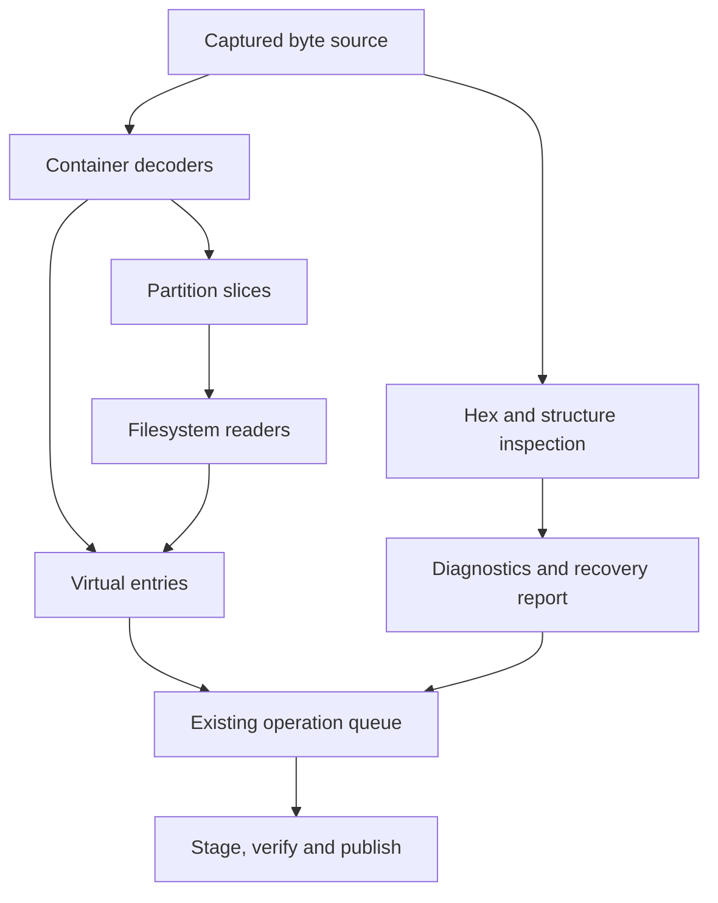

# Storage capability expansion: archive, container and filesystem workbench

Status: source-backed architecture and library assessment, followed by runtime
implementation. **LZFSE DMG reading**, **read-only GPT/MBR inspection linked
to Hex**, **bounded UDF reading**, and **ZIP recovery to a new file** are now
implemented on the integration branch. See the [DMG codec profiles](archive-dmg-codecs.md),
[partition inspector](disk-partition-inspection.md), [UDF profile](archive-udf-profile.md)
and [ZIP recovery profile](archive-zip-recovery.md). The [first runtime evidence](evidence/storage-runtime-20261114)
and [UDF/ZIP evidence](evidence/storage-udf-zip-20261114) retain their separate
qualified revisions. Later stages remain proposals; the initial assessment's
documentation-only receipt stays preserved with its original source revision.

Review: [draft PR #101](https://github.com/CrispStrobe/CrispCloud/pull/101).

## Reconciled baseline

On 2026-11-14 all remote branch heads, tags and `refs/pull/*/head` were fetched.
All **10 existing branch heads** and **90 historical pull-request heads** are
ancestors of `4d65b86dab36ca8f5dcd192c776de369aa5a4932`. There were no open PRs.
No additional merge or recovery of divergent content was necessary.

The previous handoff's merge, `81639c44da5c9c905e5bcbe8d04308fce7bda17a`, is
seven commits behind this baseline. Those commits include viewer long-line
handling, newer canonical Office sources, reader cleanup and release evidence.
They are retained intact.

The working branch is
[`integration/storage-capabilities-20261114`](https://github.com/CrispStrobe/CrispCloud/tree/integration/storage-capabilities-20261114).
Checkpoints are pushed as the assessment and implementation develop. Existing branches remain.
The complete source refs and ancestry outcomes are in
[`evidence/storage-capabilities-20261114/ancestry.json`](evidence/storage-capabilities-20261114/ancestry.json).

During implementation, main advanced to `b84f450cbf8519e9c0107928d99e0372468b85ca`
with the CLI disk-usage feature. That change was merged into this branch at
`26540f65fd63713ca1b543f793aa2e5d4a75c650` before the first runtime checkpoint.

Before UDF/ZIP work, main's native metadata catalogue and shared Rust CAF
interchange (`14e022eb51c417803a1913131e78912a8a19b3be`) were brought in through
`e49c874653f38becf0018d868c6767c264306e3f`. No fetched branch or PR head was
discarded. Subsequent checkpoints preserve the UDF reader, recovery workflow,
independent fixtures and qualification evidence incrementally.

## Scope and license filter

Evaluate additions for archive inspection/recovery, filesystem and partition
browsing, disk/container formats, structured hex tools and robust copying.
The requested filter accepts MIT, Apache-2.0, BSD, MPL and comparable terms;
excludes GPL and noncommercial restrictions. This assessment also excludes
LGPL-backed additions unless the user changes that constraint explicitly.
Licenses apply to the selected implementation and its runtime dependencies,
not merely its wrapper. A permissive wrapper around a GPL/LGPL engine is not
an accepted implementation.

This is an addition policy, not a relicensing of CrispCloud. The repository's
existing `LICENSE.txt` is GNU AGPL v3; individual existing packages have their
own license and attribution records.

## Recommendation

Extend the existing byte-source, archive and operation contracts into a disk
and filesystem workbench. The first useful additions are **LZFSE DMG reading,
bounded UDF reading, ZIP salvage to a new file, and a GPT/MBR inspector linked
to the current hex view**. Follow with read-only filesystem adapters and
recovery tools. These close identifiable gaps without replacing working archive
or transfer engines.

The UDF increment uses an original MIT Dart implementation of a documented
physical-partition profile, so it adds no .NET or native dependency. Use a small
C/Rust bridge or selected DiscUtils modules where a later format has a concrete
advantage. Avoid
automatically introducing C, Rust, Go and .NET runtimes together: several
candidates are alternatives, and many of their headline features already ship.
OCI image browsing can start with existing TAR and JSON facilities; a Go
containerregistry helper becomes useful when registry interoperability is a
separate product goal.

### Existing capabilities to preserve

The following findings come from the source at the reconciled baseline, not
from assumptions about a generic file manager.

| Area | Already present | Useful increment |
| --- | --- | --- |
| Archive formats | ZIP/7z/TAR/RAR/ISO/DMG, package readers and many codecs, with distinct read/create/edit profiles | LZFSE blocks, UDF-only images, ZIP salvage, VM and OCI semantics |
| Archive operations | Shared queue, batch testing/extraction, streamed eligible native workspaces, inspected writers and staged publication | New adapters and recovery operation types in the same queue |
| Hex editing | MIT editor with virtualized rows, nibble input, search, selection, insertion, undo and verified save | Typed data interpretation, structural drill-down, binary diff and patch export |
| Hex viewing | Native F3 already uses lazy byte windows | Version-bound remote and nested-container ranges |
| Binary structures | Apache-2.0 parser for bounded PNG/Wasm/ELF/PE/Mach-O/ZIP/Java headers | Lazy partition/filesystem metadata and validation findings connected to byte selections |
| Copy and recovery | Durable entry journals, path claims, verified-prefix recovery and staged verification | Aggregate bandwidth allocation, damaged-media extent maps and completion of latent delta paths |
| Native copy efficiency | CoW cloning, genuine preallocation and platform metadata facilities | Profile-specific sparse/extent handling and independent qualification |

Evidence: [format coverage](archive-format-coverage.md),
[archive gap register](file-manager-gaps/03-archives-and-containers.md),
[hex integration](hex-editor-integration.md),
[binary parser](../lib/services/binary_structure_service.dart),
[transfer queue](transfer-queue.md),
[transfer recovery](../lib/services/transfer_recovery_service.dart), and
[native copy primitives](../lib/services/native_copy_primitives_io.dart).
Those documents contain historical verification claims with their own pins;
this assessment does not rerun or extend those claims.

## Candidate libraries

License descriptions below apply to the identified source component. They are
not approval of every optional dependency, bundled executable, example,
database, build script or precompiled distribution. Exact reviewed source
revisions and build graphs must be selected before integration.

### Archives and compression

| Candidate | License and primary evidence | Role in CrispCloud | Material boundary |
| --- | --- | --- | --- |
| Apple lzfse | [BSD-3-Clause](https://github.com/lzfse/lzfse/blob/master/LICENSE); [project](https://github.com/lzfse/lzfse) | Decode LZFSE-compressed DMG blocks behind the current DMG reader | Codec only: no DMG encryption, APFS or partition parsing. Native C and browser implementations need separate qualification. |
| minizip-ng | [zlib](https://github.com/zlib-ng/minizip-ng/blob/develop/LICENSE); [features and options](https://github.com/zlib-ng/minizip-ng) | Recover a damaged/missing ZIP central directory into a fresh verified output; investigate split-ZIP profiles | Directory recovery cannot restore missing payload bytes. Disable automatic dependency fetching; explicitly choose codecs, crypto and character conversion. |
| libarchive | [Mostly BSD-2-Clause, with documented exceptions](https://github.com/libarchive/libarchive/blob/master/COPYING); [formats](https://github.com/libarchive/libarchive/wiki/LibarchiveFormats) | Optional uncommon-format backend or independent verification oracle | Much of its coverage is already present. It is a streaming reader/writer, not an in-place editor or replacement for current encrypted 7z/RAR handling. |
| libzip | [BSD-3-Clause](https://libzip.org/license/); [API](https://libzip.org/documentation/libzip/) | Alternative transactional ZIP backend if a concrete gap warrants it | Existing ZIP editing and publication already cover the core use case. Do not add a second editing engine merely for its format list. |
| liblzma / LZMA SDK | [liblzma 0BSD](https://github.com/tukaani-project/xz/blob/master/COPYING); [SDK public domain](https://www.7-zip.org/sdk.html) | Selected codec implementation or native acceleration if needed | Existing XZ/LZMA coverage already ships. liblzma is not the whole XZ source tree; the SDK is not the whole 7-Zip distribution. |

For libarchive, keep ENABLE_LZO and ENABLE_NETTLE disabled and make an explicit
decision about ENABLE_ICONV and its implementation. Constrain external filter
execution; its format documentation describes fallbacks to installed programs.
Its COPYING file distinguishes source-file licenses from varying build-script
licenses. Select the Apache-2.0 or CC0 grant where the BLAKE2 sources offer
alternatives. Preserve per-file attribution.

For minizip-ng, the upstream build exposes MZ_ICONV, crypto backends and
MZ_FETCH_LIBS. A zlib top-level license does not establish the license of the
chosen iconv implementation or every fetched library. Configure a reproducible,
explicit build; do not import the default dependency graph without checking it.

If libzip is selected, disable its currently default-on ENABLE_GNUTLS under this
conservative policy and choose a reviewed platform/OpenSSL configuration. Its
current LIMIT_LZMA_WINDOW option defaults off: set a deliberate decoder window
bound or disable that compression method. An archive output-size cap does not
automatically cap a codec's internal allocation.

### Partition, filesystem and disk-image engines

| Candidate | License and primary evidence | Useful capability | Limits and integration cost |
| --- | --- | --- | --- |
| gptman + mbrman | MIT OR Apache-2.0; [gptman](https://github.com/rust-disk-partition-management/gptman), [mbrman](https://github.com/rust-disk-partition-management/mbrman) | Parse, inspect and selectively write GPT/MBR partition tables | A table editor does not relocate file contents or resize a filesystem. Image-only inspection is the initial scope. |
| rust-fatfs | [MIT](https://github.com/rafalh/rust-fatfs/blob/master/LICENSE.txt); [features](https://github.com/rafalh/rust-fatfs) | FAT12/16/32, long names, file/directory operations and formatting | Not exFAT. Start read-only; FAT image creation/editing can be a separately qualified writer profile. |
| ChaN FatFs | [BSD-style terms in the official application note](https://elm-chan.org/fsw/ff/doc/appnote.html) | Portable C FAT/exFAT with block callbacks and a configurable read-only build | Separate from rust-fatfs. Upstream also discusses exFAT patent rights; the code license is not a blanket conclusion on those rights. |
| ext4-view | MIT OR Apache-2.0; [source and licenses](https://github.com/nicholasbishop/ext4-view-rs) | Read-only ext2/ext3/ext4 access through a supplied reader | Useful for browsing/extraction. Unsupported incompatibility features and corruption must be distinct outcomes. No repair/write claim. |
| ColinFinck/ntfs | MIT OR Apache-2.0; [features and exclusions](https://github.com/ColinFinck/ntfs) | Read-only NTFS metadata, directory traversal, attributes, sparse data and alternate streams | Upstream excludes writes, compression, encryption, journaling, reparse points and security descriptors. Do not silently flatten unsupported cases. |
| DiscUtils | [MIT](https://github.com/DiscUtils/DiscUtils/blob/develop/LICENSE.txt); [scope](https://github.com/DiscUtils/DiscUtils) | UDF/ISO/FAT/NTFS and VM containers such as VHD/VHDX/VDI/VMDK/XVA | C#/.NET helper or reviewed port, not a Dart package. Select modules; verify read/create/edit separately for every format. |
| go-diskfs | [MIT](https://github.com/diskfs/go-diskfs/blob/master/LICENSE); [current API](https://github.com/diskfs/go-diskfs) | MBR/GPT, FAT32, ISO9660, SquashFS, ext4 and a limited read-only EROFS profile | Go helper alternative. ISO/SquashFS creation uses finalization, not arbitrary editing afterward. No QCOW support merely because it appears on a roadmap. |
| go-apfs | [Apache-2.0](https://github.com/blacktop/go-apfs/blob/main/LICENSE); [project](https://github.com/blacktop/go-apfs) | Experimental APFS listing and extraction | Research only: upstream labels it WIP. Current go.mod includes lzfse-cgo; do not assume a pure-Go/Wasm build or encrypted APFS support. |

The smaller Rust components give a controlled native scope and can reuse the
repository's Rust dependency review patterns. DiscUtils is the strongest broad
candidate when UDF and VM disk formats justify a desktop helper. go-diskfs is
an alternative when a Go image service is preferred. The recommendation is to
choose against fixture coverage and packaging cost, rather than adopt all three.

An initial browser implementation should expose only parsers that actually
compile and pass browser tests. A Rust or C library being theoretically
compilable to Wasm does not establish its I/O, memory, thread or integer behavior
in the browser. None of these libraries grants browser access to physical disks.

### OCI and Docker containers

[google/go-containerregistry](https://github.com/google/go-containerregistry)
is [Apache-2.0](https://github.com/google/go-containerregistry/blob/main/LICENSE).
It offers image manifests, indexes, layers, registries, tarballs, layouts and
mutation/export APIs. This is a useful independent meaning of “container” in
addition to disk images and archives.

A user-facing OCI browser should show both individual layers and a merged file
tree, including the layer that supplied each visible file. Implement whiteout
deletions and opaque-directory semantics; a list of TAR members does not
represent the final root filesystem. Check descriptor sizes and digests, bound
layer expansion, and never execute image entrypoints. Treat links and special
files as metadata unless the extraction policy explicitly supports them.

Existing TAR readers make a smaller offline Dart implementation plausible.
The Go library is a candidate backend or reference oracle; registry credentials,
remote writes and network access should be separate capabilities.

### Hex, identification, copy and backup

| Candidate | License and primary evidence | Best use | Boundary |
| --- | --- | --- | --- |
| binrw | [MIT](https://github.com/jam1garner/binrw) | Declarative Rust binary structures, attached to existing hex ranges | Layout parsing/writing alone is not semantic repair. |
| file/libmagic | [BSD-style two-clause terms](https://github.com/file/file/blob/master/COPYING) | Content-based type hints for misnamed files and recovered fragments | Inspect selected magic database and dependencies. Identification is not validity or integrity verification. |
| BLAKE3 | [Apache-2.0 option](https://github.com/BLAKE3-team/BLAKE3/blob/master/LICENSE_A2) | Strong extent hashes, diff caches and optional fast verification | Preserve SHA-256 compatibility in existing journals; benchmark before changing algorithms. |
| xxHash library | [BSD-2-Clause](https://github.com/Cyan4973/xxHash/blob/dev/LICENSE) | Fast candidate filtering before strong comparison | Noncryptographic. Its [CLI has GPL terms](https://github.com/Cyan4973/xxHash/blob/dev/cli/COPYING), so select only the intended library. |
| rclone | [MIT](https://github.com/rclone/rclone/blob/master/COPYING); [RC API](https://rclone.org/rc/) | Optional native provider bridge and supported server-side operations | Keep CrispCloud's durable journal authoritative. rclone does not supply universal partial-file resumption or binary deltas. |
| Xdelta 3, Apache branch | [Current upstream licensing](https://github.com/jmacd/xdelta) | VCDIFF patch export/application for large images | Choose a reviewed Apache source branch, not xdelta-gpl or Xdelta 1. Bind base and result hashes and apply to staging. |
| openrsync | [ISC](https://github.com/kristapsdz/openrsync/blob/master/LICENSE.md); [scope](https://github.com/kristapsdz/openrsync) | Optional Unix/SSH delta transfer | Protocol 27 and a subset of rsync behavior; not a universal Flutter or Windows backend. |
| restic / Kopia | [restic BSD-2-Clause](https://github.com/restic/restic/blob/master/LICENSE), [Kopia Apache-2.0](https://github.com/kopia/kopia/blob/master/LICENSE) | A future versioned, deduplicated backup product feature | Backup repositories, retention and restore are separate semantics from ordinary copy/move. Choose one after a restore requirement is defined. |

Deeper executable inspection could optionally use
[goblin (MIT)](https://github.com/m4b/goblin) and
[Capstone (BSD core, plus bundled notices)](https://github.com/capstone-engine/capstone).
These are secondary to disk and container structures for this request.

rclone's [FAQ](https://rclone.org/faq/) describes its partial-transfer limitation.
Its [check command](https://rclone.org/commands/rclone_check/) can perform
downloaded-content comparison when selected; ordinary backend checksum options
do not imply a strong end-to-end digest on every provider. Report the actual
verification mode. RC process jobs must not replace restart-safe app records.

## Recovery and repair are separate operations

The useful distinctions are: diagnose metadata, salvage valid archive members,
carve content from raw bytes, recover deleted files from surviving filesystem
metadata, image damaged media, and modify filesystem metadata. One successful
parser or checksum check does not implement all of these.

[sleuthkit/scalpel](https://github.com/sleuthkit/scalpel) is a real Apache-2.0
carving candidate with a library API. Its own README says maintenance stopped
after integration encountered memory leaks and that official releases are not
being produced. Its stock Windows package includes LGPL pthreads and TRE
dependencies. Evaluate only an audited source subset with suitable dependencies
and resource limits; do not approve the distribution as-is. The different
[Scalpel3 project](https://github.com/nolaforensix/scalpel3-release) is GPL and
is excluded.

An original bounded carver for a small set of formats may be easier to maintain.
Begin with validated JPEG/PNG/PDF/ZIP-family candidates, chunk-boundary-safe
signature detection and format-aware end/length validation. Export to another
destination with source offsets, ranges, hashes and validation findings.
Mark missing or unreadable ranges explicitly. A magic/footer match by itself
must not produce a “fully recovered” result.

Carving does not normally reconstruct original names, directories or arbitrary
fragmentation. FAT deleted-entry recovery and NTFS MFT-based recovery are
separate future profiles that need metadata-specific implementations. The
read-only filesystem libraries above are not advertised as undelete engines.

For damaged-media imaging, use a durable extent map recording unattempted,
read, failed, retried and intentionally skipped regions. Keep offsets stable
and let users retry selected failures without rereading everything. A hole or
zero-filled failed sector must remain distinguishable from a successfully read
zero sector. No complete, maintained permissive replacement for GNU ddrescue's
whole workflow was established in this study.

## Exclusions and license traps

| Candidate | Why it does not meet the selected policy |
| --- | --- |
| PhotoRec / TestDisk | [GPL v2 or later](https://www.cgsecurity.org/wiki/TestDisk). Workflow inspiration, not an approved embedded engine. |
| GParted / GNU Parted | GPL tools; a permissive partition-table parser is a different scope from filesystem resizing. |
| ImHex / PatternLanguage | [ImHex GPL](https://github.com/WerWolv/ImHex); [PatternLanguage LGPL](https://github.com/WerWolv/PatternLanguage). An MIT grammar is not the execution engine. |
| GNU rsync / ddrescue | [rsync GPL](https://rsync.samba.org/GPL.html), [ddrescue GPL](https://www.gnu.org/software/ddrescue/). An external wrapper does not change this product dependency policy. |
| bit7z plus ordinary 7-Zip backend | [bit7z MPL wrapper](https://github.com/rikyoz/bit7z) still requires a [7-Zip backend with LGPL/unRAR terms](https://www.7-zip.org/license.txt). |
| lwext4 default/full build | [Upstream](https://github.com/gkostka/lwext4) documents GPL extents and xattr source within otherwise BSD code. Do not describe the whole library as BSD. |
| libfsapfs and libudfread | LGPL implementations, excluded by the conservative policy used here. |
| Kaitai as an undifferentiated package | [Compiler/visualizer GPL, runtimes separately licensed](https://kaitai.io/). Use existing Dart parsing or binrw under the current strict scope; revisit build-time compiler use only as a distinct decision. |

Existing app licensing is a separate question from new dependencies.
[The current audit](fuse_and_license_audit.md) records AGPL app licensing,
LGPL libfuse headers and libsmb2 notices, and an optional separately installed
FUSE-T path gated on noncommercial use. The FUSE runtimes are not bundled by
that build script. This study does not establish that the existing application
is GPL/LGPL/NC-free and does not silently change those profiles.

## Integration design

### Reuse the current source and publication contracts

The proposed layering is a design, not a report of implemented filesystem
support:

The existing koni ByteSource already has length, positional reads and close
semantics. ArchiveSliceSource bounds a child region; ArchiveCheckpointSource
provides awaited operation checks. Keep these as the adapter boundary.
The shared [archive viewer dispatch](../lib/services/archive_viewer_service.dart)
can return [ViewerArchive](../lib/services/archive_types.dart) for new readers,
so panes, F3, search and extraction use the established route.

Native adapters must bridge asynchronous Dart sources to any synchronous C/Rust
reader without blocking the UI or silently downloading an unbounded image.
A worker/helper with explicit range requests or a reviewed bounded local spool
are possible implementations. Benchmark actual seeks and reads; API similarity
alone does not resolve the asynchronous I/O boundary.

Every opened root must retain its account, path, exact length and available
version identity. All child ranges inherit it. A cloud ETag is not universally
a content hash, and an unpinned sequence of HTTP ranges is not a snapshot.
Where the provider cannot supply stable conditional reads, use the existing
verified snapshot path or disclose that the requested profile is unavailable.
Cancellation, revoked access and a changed root invalidate its descendants.

Keep logical and physical offsets separate. A filesystem file can have several
extents; a VM disk may be sparse or backed by parent images; compressed bytes do
not have a one-to-one decoded offset. Structure nodes should link to the
appropriate source region or block map and label the coordinate system.
Never present a decoded offset as a direct patch location in the outer file.
Parent-image paths and links inside an image are untrusted metadata and must
not silently open unrelated host files.

### Declare each operation and profile independently

Capability records should cover detect, list, read-range, extract, verify,
recover-to-new, create, rebuild and in-place-write separately. They also need
target availability, source requirements, encryption state, unsupported flags,
resource limits and metadata preservation policy. Recognition of an APFS or
UDF signature must not enable write controls.

Reuse [ArchiveEndpointPolicy](../lib/services/archive_endpoint_policy.dart),
[ArchiveWorkspace](../lib/services/archive_workspace.dart) and
[ArchiveContainerPublisher](../lib/services/archive_container_publisher.dart).
New readers remain read-only until their writer profile has its own proof.
Recovery should normally publish a new artifact through a private
[ArchiveOutputSpool](../lib/services/archive_output_spool.dart), rather than
promoting damaged input into a writable workspace.

Distinguish corruption, unsupported features, password needed, source changed,
read error, cancelled and resource limit. A corrupt-input or cancellation result
must not cause an automatic fallback that discards those guarantees. Successful
enumeration is not verification of every member, and a valid CRC is not
authentication of a package or publisher.

The current 64 MiB buffered-member limit, eligible 8 GiB native streamed
profiles, separate browser/container limits and nested-wrapper bounds remain
separate contracts. New decompression and metadata parsers also need internal
allocation, recursion, directory-entry, extent-count and elapsed-work budgets.
Do not raise existing operation ceilings simply because a library accepts
64-bit offsets.

### Platform scope

| Target | Initial design scope | Additional qualification |
| --- | --- | --- |
| Desktop | Existing user-selected files and images; C/Rust FFI or a confined helper where justified | Package exact binaries and notices; validate short reads, cancellation, crash isolation and file identity |
| Mobile | App-visible files/images through granted handles; selected packaged native modules | Platform packaging, scoped access, memory pressure and foreground/background behavior |
| Browser | User-granted files and supported cloud ranges; current Dart parsers and separately qualified Wasm modules | Integer precision, memory growth, workers, async I/O, CSP and cancellation |
| Physical devices | A future native broker with explicitly scoped access | OS-specific device identity, permissions, geometry, mounted-volume handling and interruption behavior |

Physical partition editing is a later feature with materially different
failure modes. Start with image-only diagnostics and edits to a new image or
overlay. Updating a GPT boundary cannot stand in for moving filesystem extents
or resizing allocation structures. There is no evidence in this study for
general safe APFS repair, arbitrary filesystem resizing or a universal fsck.

## Delivery sequence and acceptance

These are scoped implementation stages, not estimated delivery dates. Stages
1 (GPT/MBR tables only), 2, 3 (physical UDF profiles) and 4 (bounded ZIP
recovery) are implemented on the integration branch. The linked profiles and
receipts define their qualified scope. Broader filesystem metadata and
container structure inspection in stage 1 remain future work.

### 1. Disk structures in the current viewer

Implemented first profile: [bounded GPT/MBR inspection](disk-partition-inspection.md)
with exact Hex selections, separate primary/backup CRC checks and source
cancellation. Filesystem superblocks and container maps below remain future work.

Add lazy GPT/MBR headers and entries, boot sectors, filesystem superblocks and
container block maps to the current structure view. Selecting a field should
select its bytes in Hex. Display types, endianness, GUIDs, sector sizes, offsets,
primary/backup discrepancies, CRC errors and out-of-range/overlapping spans.
Use bounded structure expansion rather than increasing the current prefix
buffer to the size of a disk.

Acceptance needs 512/4096-byte sectors, malformed lengths/counts, backup GPT,
large offsets, EBR loops where supported, partition overlap, truncated input,
source replacement and cancel during expansion. Findings must distinguish a
damaged table from a recognized but unsupported structure.

### 2. LZFSE DMGs

Implemented profile: [bounded Dart LZFSE DMG decoding](archive-dmg-codecs.md),
including v1/v2, LZVN, raw blocks, mixed streams and validated table reuse.
[Runtime receipts](evidence/storage-runtime-20261114) record native, compiled-JS
and independent oracle qualification.

Extend the current DMG block-decoder boundary and retain its HFS+/HFSX/ISO/raw
partition views. Apple's public lzfse_decode_buffer can return the output-buffer
size when the buffer fills without establishing a complete decode. Allocating
the declared output length and checking that return value alone is insufficient.
Use a bounded reviewed shim/port that confirms a successful end condition,
exact decoded length and allowed input consumption/padding for the chosen
profile.

Test independently produced fixtures, exact-boundary and overlong output,
truncation, malformed block tables, mixed compression types and cancellation.
Compare extracted file hashes using an independent implementation. Keep
encrypted DMGs, APFS and DMG writer support outside this increment.

### 3. UDF reading

Implemented: an [original MIT positional Dart reader](archive-udf-profile.md)
for UDF 1.02/1.50/2.00/2.01 physical Type 1 partitions, FE/EFE, embedded and
short/long allocation forms, bounded continuations, ordered multiple extents
and sparse regular files. UDF-only and ISO/UDF bridge images use the UDF
namespace in pane/F3/extraction and stay read-only. Supported UDF partitions
inside DMGs also expose their files and preserve the raw partition entry.

The native and browser paths share the same positional reader. Independently
mastered UDF 1.02 media and synthetic structures exercise extraction, ordered
multiple extents, exact large offsets, descriptor checks, loops, invalid ranges
and explicit unsupported cases. Native F3 keeps its bounded source windows.

Later extensions need separately specified and qualified partition maps,
revisions and recovery behavior. VAT, sparable and metadata partitions are
outside this increment. Selected DiscUtils modules remain an option for broader
filesystem/VM formats if their integration cost is justified.

### 4. ZIP salvage

Implemented: **Recover ZIP to new file…** for a selected native local ZIP/CBZ.
The [documented recovery profile](archive-zip-recovery.md) captures a 64 MiB
bounded snapshot, reviews verifiable local records, rebuilds selected entries
and verifies them with the separate Koni reader before exclusive new-file
publication. Deflate data descriptors are accepted only from measured codec
completion and matching CRC/sizes. The shared Operations queue owns recovery,
verification and publication after admission; closing the review does not stop
an admitted job. Source hashes, selection offsets and output receipts are
journaled without source bytes or credentials. After restart, a fresh source
scan and selection review are required.

Qualification covers missing directories, truncation, incorrect sizes/CRC,
name conflicts, nested signatures, measured deflate descriptors and explicit
refusal of encryption, ZIP64 and recognized split sets. Python's separate ZIP
reader verifies the rebuilt outputs. Publication rehashes the original and
staged candidate, repeats proofs after pauses, and uses the existing exclusive
new-file boundary. A completed install remains successful if Stop or a
completion observer arrives afterward.

Future work can extend resource limits or add separately proven record forms.
This profile does not guess unknown boundaries or claim complete recovery from
a verified prefix; source contents and credentials are not durable job data.

### 5. Filesystems and containers

Add FAT, ext and NTFS reading through a selected adapter stack. Connect each
partition to the existing virtual-entry route. Preserve alternate-stream names,
sparse semantics, timestamps and unsupported metadata notices where available.
Then extend the UDF profile, add VM families or add offline OCI semantics according to actual demand.

Cross-check representative extraction hashes with independent tools. Exercise
fragmented files, extent loops, sparse/unallocated ranges, huge declared sizes,
dirty volumes, unsupported feature flags and truncated metadata. A
filesystem reader must not perform write-side journal replay merely to list
files. VM fixtures must include missing/changed parents and unsupported
compression or encryption.

### 6. Recovery and binary comparison

Add bounded same-offset byte comparison and changed-range navigation first.
Xdelta patch files are a later export format; bind their expected base and
result identities, limit work, apply to a private candidate and verify before
publication. Retain the original if a patch fails.

Carving and rescue imaging should be separate operation types with distinct
reports. Test signatures across chunk boundaries, fragmented/truncated data,
false positives, overlapping candidates, unreadable ranges and restart with
changed source identity. A rescue extent-map checkpoint is only durable when
the associated output data has reached the required durability boundary.

### 7. Complete transfer gaps

The existing [G29 bandwidth design](file-manager-gaps/transfer-bandwidth-design.md)
already scopes aggregate upload/download allocation. Implement it at actual
stream boundaries, with fair admission and permit release on pause, cancellation
and failure. This delivers user value without another copy engine.

The source review also found incomplete delta-transfer entry points worth
hardening before wider exposure. The S3 cached block map lacks the version
comparison described by its comment; direct delta application lacks staging,
strict per-block result checks and final-length handling; shrink-only updates
can evade a changed-block test. pCloud delta upload modifies an existing remote
file directly. Ordinary queue caller wiring was not established by the search.

These are source-level observations and hypotheses, not reproduced production
failures or a finding that ordinary journaled copy is broken. The
[pinned investigation note](evidence/storage-capabilities-20261114/delta-source-review.txt)
records locations, source hashes, reachability uncertainty and the required
reproductions. A future fix should use identity-bound block maps, strict range
and digest checks, explicit final size, private staging and the existing
publication/recovery contracts.

## Source admission and evidence

Reuse the repository's existing verification patterns:

- [Selected binary-parser imports](../tool/verify_file_viewer_binary.py) and
  [provenance definitions](../tool/file_viewer_provenance.py): exact upstream
  commit, allowlisted sources, Git blob IDs, SHA-256, modification records and
  attribution.
- [Hex vendor verification](../tool/verify_hex_vendor.py): keep canonical fork
  identity distinct from the application's local snapshot.
- [Document-runtime verification](../tool/verify_document_runtime.py): bind
  compiled assets, source inventories, notices and overlays.
- [Rust license checking](../packages/crisp_storage/tool/check_rust_licenses.py):
  resolve the locked selected graph, review exact SPDX expressions and record
  the chosen permissible license alternative.
- [Binary-parser license registration](../lib/services/file_viewer_binary_license.dart):
  make distributed notices reachable in the app.

Before adding a dependency, pin a reviewed source/release, select build features
explicitly, review the actual runtime graph and shipped binaries, preserve
notices and source obligations, and qualify the intended operations separately
on each target. A license/hash check is evidence of source identity, not proof
of parser correctness or platform support.

The [evidence directory](evidence/storage-capabilities-20261114) preserves three
candidate ledgers: archive/container, filesystem/recovery, and hex/copy.
Together they record **27 entries including an explicit lwext4 exclusion**,
with **63 pinned source files, including 33 license files**. Exact byte lengths,
SHA-256 values and Git blob identities were independently rechecked against the
retrieved bytes. No third-party runtime code was imported.

The immutable URLs in those ledgers govern this research snapshot; general
project links above may continue to change. Observed upstream branch heads are
not approved dependency pins or qualified releases. The ledger checks are
recorded in [evidence-validation.json](evidence/storage-capabilities-20261114/evidence-validation.json).
The [ancestry receipt](evidence/storage-capabilities-20261114/ancestry.json)
preserves every original remote branch and PR head from this pass.

The new branch is an evaluated roadmap and supporting evidence. Application
source, dependency manifests and runtime capability declarations are unchanged.
Consequently this pass has no new app, native, browser or device test results;
the previous session's receipts remain attached to their original source.
