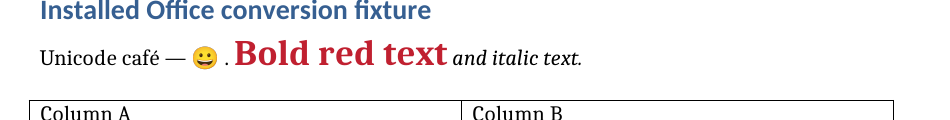
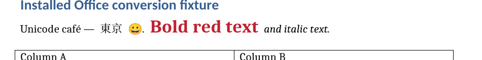

# Formatting font attribution: Tokyo and emoji

The final parser output visibly preserves both `東京` and the source's one
emoji. There is no source emoji loss. The native binary reference omits visible
`東京`, and its extracted word stream contains a duplicated emoji token even
though only one emoji is visible. An initial token diff removed one occurrence
of that duplicate; it did not establish loss of the source character.

This review uses the retained final native source
`0c3e59682952cce0e11301afec789e7ae2a1256a`. It does not change the measured
reports or claim another native run. [font-attribution.json](font-attribution.json)
contains the source, DOCX, word-box and artifact hashes.

## Source and output declarations

The original `formatting.doc` hash is
`0ad636c6e3597152313055fd5428fb4b70ab483b3853b2666cac52498c953026`.
Its main story contains exactly one `東京` and exactly one U+1F600 emoji.
The run at CP `[36,58)` is `Unicode café — 東京 😀. `; the emoji occupies
UTF-16 CP 54–55 as `D83D DE00`. Its raw little-endian bytes `3D D8 00 DE`
occur at `WordDocument` stream offset 2156.

The source Normal character properties explicitly select font indices
4 / 5 / 4 / 6. The retained raw property bytes match the source table at
offsets 84 and 3916; both matching sequences are reported rather than assuming
the sequence occurs uniquely. Independent stylesheet traversal locates the
Normal record at offset 22 and its 51-byte character-property block at 84.
The explicit operands occur at 87 (ASCII index 4), 91 (hAnsi index 4),
111 (East Asian index 5), and 123 (complex-script index 6).
Independent font-table decoding identifies the
Cambria record at offset 9601, the `ＭＳ 明朝` record at 9657, and the empty
complex-script face at 9709. The global stylesheet defaults are Times New Roman;
the resolved run uses the more specific source selections shown below.

| Slot | Source resolved face | Final parser `rFonts` | Native DOCX Normal `rFonts` |
| --- | --- | --- | --- |
| ASCII | Cambria | Cambria | Cambria |
| Other non-ASCII / hAnsi | Cambria | Cambria | Cambria |
| East Asian | ＭＳ 明朝 | ＭＳ 明朝 | ＭＳ 明朝 |
| Complex script | Explicit empty face | Empty `cs` | Empty `cs` |

The earlier parser incorrectly wrote Cambria into the East Asian slot as well.
The final parser's direct run and paragraph-mark declarations preserve the
source-specific face. The native DOCX export has matching declarations through
its Normal style. All old/final parser and native DOCX documents retain literal
`東京 😀` text; the final DOCX contains one instance of each source token.

The [source inspection](font-render-inspection/source-font-slots.json),
[exact byte anchors](font-render-inspection/normal-style-byte-evidence.json),
[independent Normal operands](font-render-inspection/source-normal-font-operands.json),
and [DOCX XML comparison](font-render-inspection/docx-font-comparison.json)
retain those observations. The source inspection was independently repeated
with its formatted Dart helper and reproduced the same JSON bytes.

## Direct visual evidence

These are actual PNG crops generated from the retained measured PDFs. The
diagnostic crop uses 144 DPI for readability; the primary native measurements
remain the unchanged 72-DPI RGB receipts. Neither image is generated artwork or
a substituted reference.

**Native binary source render:** one visible emoji; Tokyo absent.



**Final parser render:** Tokyo and one visible emoji.



| Render | Total extracted words | Extracted Tokyo tokens | Extracted emoji tokens | Visible emoji count |
| --- | ---: | ---: | ---: | ---: |
| Native binary source | 44 | 0 | 2 | 1 |
| Final parser DOCX | 44 | 1 | 1 | 1 |
| Native-exported DOCX | 45 | 0 | 2 | 1 |

The old parser's extracted sequence matches the binary source on this line.
The final source's binary reference is identical to the old reference in both
word geometry/text and raw raster fingerprints. Thus the duplicate token is
not a new native reference change. All these observations use the same installed
font environment. PDF font inventories record Noto Color Emoji in both renders;
the final parser PDF additionally uses Noto Serif CJK SC for the recovered
East Asian text.

The initial full-page word-sequence comparison must remain marked different.
The previous 11.902-point corresponding-word displacement is now incomparable,
not zero. All three parser repeat imports remain exact against both the first
and previous parser outputs. This is supported source-property preservation
with an attributed native-consumer difference; it is not exact visual fidelity
to the native binary renderer or a complete explanation of every consumer
font-selection behavior.

## Reproduction

The complete measured PDFs are retained in the native case archive and copied
unchanged into `font-render-inspection/`. To reproduce the crops from that
directory:

```sh
pdftoppm -f 1 -l 1 -r 144 -x 140 -y 200 -W 950 -H 120 \
  -png -singlefile render-binary-source.pdf binary-line
pdftoppm -f 1 -l 1 -r 144 -x 140 -y 200 -W 950 -H 120 \
  -png -singlefile render-converted-converted.pdf parser-line
```

Run the source helpers with the measured Dart SDK and the parser's existing
package configuration, from the parser repository root:

```sh
dart --packages=.dart_tool/package_config.json \
  /path/to/font-render-inspection/formatting_font_source.dart \
  test/fixtures/word_native/formatting.doc
dart --packages=.dart_tool/package_config.json \
  /path/to/font-render-inspection/verify_font_bytes.dart \
  test/fixtures/word_native/formatting.doc
```

The JSON's diagnostic-file manifest binds the PDFs, PNGs, source helpers,
source readings, XML comparison, extracted text and font inventories by SHA-256.

The diagnostic helpers use the existing `sha256sum` command to bind their
source bytes without adding a parser package dependency.

The three retained Dart helpers pass scoped formatting and fatal-info analysis
under the actual parser repository configuration. Each helper reproduces its
retained JSON output byte for byte after the diagnostic lint corrections.
`font-render-inspection/diagnostic-helper-checks.json` records the commands and
results; the initial lint/format findings remain in separate logs. These are
diagnostic checks and do not change the measured parser runtime or native run.
The helpers use the installed `sha256sum` utility for source-file hashing.
